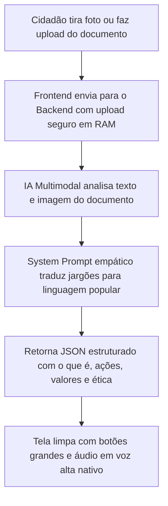

# 📄 Tradutor de Burocracia & Saúde 🇧🇷
### Decodificador Acessível de Documentos Cidadãos com IA Multimodal

> **Projeto de Extensão Universitária focado em Impacto Social e Cidadania**  
> Uma aplicação web simples, responsiva e *mobile-first*, desenvolvida para que cidadãos — especialmente idosos ou pessoas com baixo letramento funcional — compreendam contas públicas, receitas médicas e notificações oficiais sem termos técnicos confusos, contando com recurso nativo de leitura em voz alta.

---

## 🎯 Objetivo e Impacto Social

Muitos cidadãos brasileiros enfrentam grandes barreiras para compreender documentos do dia a dia:
- Contas de água e energia com jargões regulatórios ("bandeira tarifária de escassez", "débito pretérito", "consumo faturado").
- Notificações ou intimações judiciais em linguagem hermética que geram pânico desnecessário.
- Receitas médicas com termos técnicos ("posologia", "via oral", caligrafia ilegível) que dificultam a continuidade do tratamento de saúde.

**O Tradutor Cidadão resolve esse problema traduzindo esses documentos para uma linguagem acolhedora, clara e com passos práticos sobre o que precisa ser feito.**

---

## 🧭 Como Funciona a Aplicação?



1. **Captura Acessível:** O usuário fotografa a **Frente e o Verso** do documento (com slots guiados) ou envia um arquivo PDF.
2. **Decodificação Inteligente:** O backend se comunica com o SDK oficial da Google GenAI (`gemini-flash-lite-latest`), analisando múltiplos lados de imagens e texto simultaneamente.
3. **Explicação Humanizada:** A IA identifica o tipo de documento e remove qualquer jargão técnico.
4. **Tópicos de Ação Direta:** Apresenta em destaque:
   - **O que é o documento** (ex: "Conta de Luz da Enel referente a Outubro").
   - **O que este papel diz** (resumo em 2 ou 3 frases simples).
   - **Valores e Prazos** (quanto pagar e até quando).
   - **O que você deve fazer** (lista passo a passo numerada).
   - **Alertas Éticos** (ex: receitas médicas reforçam a consulta com o farmacêutico no balcão).
5. **Acessibilidade por Áudio:** Um botão destacado de **"Ouvir Agora"** aciona a síntese de voz nativa do navegador (`window.speechSynthesis`) em português brasileiro, permitindo ouvir a explicação completa sem custos adicionais.
6. **Acessibilidade Visual (Zoom Real):** Botões **A- / A+** no topo permitem aumentar proporcionalmente todos os textos, botões e cards da aplicação em 4 níveis com persistência local.
7. **Tira-Dúvidas Interativo com IA:** O cidadão pode tirar dúvidas sobre o documento usando perguntas frequentes de 1 clique, digitando ou falando pelo **Microfone**, com leitura em voz alta da resposta.

---

## 🛠️ Tecnologias e Dependências

### Backend (API REST)
Construído em **Node.js** com os seguintes pacotes:
- **`@google/genai`**: SDK oficial do Google para comunicação multimodal com o Gemini.
- **`express`**: Framework web para criação dos endpoints HTTP.
- **`multer`**: Gerencia uploads diretamente em **memória RAM** (garantindo privacidade e conformidade com a LGPD).
- **`cors`**: Liberação segura de requisições entre origens diferentes.
- **`dotenv`**: Carregamento seguro de variáveis de ambiente.

### Frontend (Aplicação Web)
Construído em **React** com **Vite** e **Tailwind CSS**:
- **`react` & `react-dom`**: Renderização reativa e componentes modulares.
- **`vite`**: Ferramenta moderna de compilação e servidor de desenvolvimento ultra-rápido.
- **`tailwindcss`**: Estilização utilitária focada em acessibilidade, alto contraste e mobile-first.
- **`lucide-react`**: Conjunto de ícones vetoriais modernos e compreensíveis.
- **`clsx` & `tailwind-merge`**: Utilitários para controle dinâmico de classes de acessibilidade.
- **`Web Speech API`**: API nativa dos navegadores para leitura por voz (dispensa serviços pagos de terceiros).

---

## 📁 Estrutura de Diretórios

```
projeto-idoso/
├── backend/
│   ├── .env.example              # Modelo de configuração de variáveis
│   ├── .env                      # Chave da API Gemini (ignorado pelo git por segurança)
│   ├── package.json              # Dependências do servidor
│   ├── server.js                 # Servidor Express (/api/analyze-document e /api/ask-question)
│   ├── prompts/
│   │   ├── documentPrompt.js     # System Prompt empático e Schema estruturado
│   │   └── qaPrompt.js           # Prompt do Tira-Dúvidas contextual
│   └── services/
│       └── geminiService.js      # Integração multimodal resiliente com o Google GenAI
│
├── frontend/
│   ├── package.json              # Dependências da interface
│   ├── vite.config.js            # Proxy configurado para a porta 3001
│   ├── tailwind.config.js        # Design tokens e tipografia de alta legibilidade
│   ├── postcss.config.js
│   ├── index.html                # Ponto de entrada com metatags de acessibilidade
│   └── src/
│       ├── main.jsx
│       ├── App.jsx               # Fluxo principal, zoom real e estados de tela
│       ├── index.css             # Estilos globais e foco acessível
│       ├── utils/
│       │   └── speech.js         # Controlador da Web Speech API nativa (pt-BR)
│       └── components/
│           ├── Header.jsx        # Cabeçalho com indicador dinâmico e zoom (A- / A+)
│           ├── DocumentUploader.jsx # Captura guiada para Frente e Verso ou PDF
│           ├── LoadingState.jsx  # Feedback acolhedor ("Lendo seu documento...")
│           ├── AudioPlayer.jsx   # Reprodutor acessível (Play/Pause/Velocidade)
│           ├── ResultCard.jsx    # Card estruturado (o que é, ações, prazos, ética)
│           └── DocumentQA.jsx    # Tira-dúvidas com IA, microfone e áudio
│
├── .gitignore                    # Garante que chaves de API e node_modules não sejam commitados
└── README.md                     # Documentação completa
```

---

## 🚀 Guia de Instalação e Execução Passo a Passo

### Pré-requisitos
- [Node.js](https://nodejs.org/) instalado (versão 18 ou superior).

---

### Passo 1: Clonar o Repositório
```bash
git clone https://github.com/GABRIELRODRIGUESCAVALCANTE/projeto-idoso.git
cd projeto-idoso
```

---

### Passo 2: Obter a Chave Gratuita da API do Gemini
1. Acesse o [Google AI Studio](https://aistudio.google.com/).
2. Faça login com sua conta Google (Gmail).
3. Clique em **"Get API key"** e selecione **"Create API key in new project"**.
4. Copie a chave gerada (ela começa com `AIzaSy...`).
> *Nota: O plano gratuito (Free Tier) não exige cartão de crédito e permite até 1.500 requisições diárias.*

---

### Passo 3: Configurar e Rodar o Backend

1. Entre na pasta `backend`:
   ```bash
   cd backend
   ```
2. Instale as dependências:
   ```bash
   npm install
   ```
   *(No Windows PowerShell, use `npm.cmd install` se scripts estiverem desabilitados)*
3. Crie o arquivo `.env` a partir do exemplo:
   - Copie o arquivo `.env.example` e renomeie para `.env`.
   - Insira sua chave de API:
   ```env
   PORT=3001
   GEMINI_MODEL=gemini-flash-lite-latest
   GEMINI_API_KEY=sua_chave_do_gemini_aqui
   ```
4. Inicie o servidor:
   ```bash
   npm run dev
   ```
   *(Ou `npm.cmd run dev` no Windows PowerShell)*

Você verá a confirmação no terminal:
```text
🚀 Servidor Tradutor de Burocracia rodando na porta 3001
🔗 Health Check: http://localhost:3001/api/health
```

---

### Passo 4: Configurar e Rodar o Frontend

1. Abra um **segundo terminal** e entre na pasta `frontend`:
   ```bash
   cd frontend
   ```
2. Instale as dependências:
   ```bash
   npm install
   ```
   *(Ou `npm.cmd install` no Windows PowerShell)*
3. Inicie a interface:
   ```bash
   npm run dev
   ```
   *(Ou `npm.cmd run dev` no Windows PowerShell)*
4. Abra seu navegador no endereço:
   👉 **`http://localhost:5173`**

---

## 💡 Dica para Usuários Windows (PowerShell)

Se ao executar comandos `npm` você receber a mensagem de erro:
> *"O arquivo npm.ps1 não pode ser carregado porque a execução de scripts foi desabilitada..."*

Você pode resolver de duas formas:
- **Forma rápida:** Adicione `.cmd` após o comando:
  ```powershell
  npm.cmd install
  npm.cmd run dev
  ```
- **Forma definitiva:** Libere a execução de scripts no PowerShell executando:
  ```powershell
  Set-ExecutionPolicy -Scope CurrentUser RemoteSigned
  ```

---

## 🔒 Segurança e Privacidade por Padrão (LGPD)

- **Armazenamento em Memória (Sem disco):** O backend utiliza `multer.memoryStorage()`. As fotos de documentos enviados pelo cidadão são processadas diretamente na memória volátil (RAM) e descartadas imediatamente após a resposta da IA.
- **Chaves de API Protegidas:** O arquivo `.gitignore` previne rigorosamente o envio acidental de arquivos `.env` para repositórios públicos.
- **Responsabilidade Ética:** A aplicação inclui avisos explícitos para que o cidadão confirme receitas médicas com farmacêuticos ou ordens judiciais com a Defensoria Pública.

---

## 🤝 Projeto de Extensão Universitária

Este projeto foi concebido como uma iniciativa acadêmica de extensão para democratizar o acesso à informação e apoiar cidadãos em vulnerabilidade informacional através do uso consciente de Inteligência Artificial generativa.
