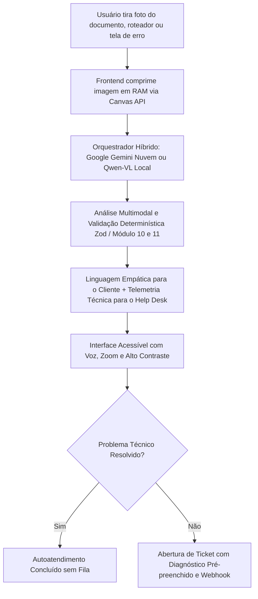

# 📄 Tradutor Cidadão & Plataforma de Suporte Técnico Inteligente 🇧🇷
### Decodificador Acessível de Documentos & Assistente Multimodal de Suporte Técnico (Tier 0 & 1)

> **Projeto de Impacto Social, Acessibilidade Universal e Inovação em Atendimento Técnico**  
> Uma aplicação web moderna, responsiva e *mobile-first*, desenvolvida para que cidadãos — especialmente idosos ou pessoas com baixo letramento funcional — compreendam contas públicas, receitas médicas, notificações oficiais e estados de equipamentos de informática/rede (roteadores e telas de erro) sem jargões confusos, contando com autoatendimento assistido por voz e integração nativa com help desks.

---

## 🎯 Objetivo e Impacto

Muitos cidadãos e clientes enfrentam grandes barreiras de comunicação no seu dia a dia:
- **Contas de água, energia e telecom** com jargões regulatórios ("bandeira tarifária de escassez", "débito pretérito", "consumo faturado", "taxa de comodato").
- **Receitas médicas** com termos herméticos ("posologia", "via oral", caligrafia ilegível) que colocam a saúde em risco.
- **Falhas de informática e internet:** Clientes leigos ou idosos não compreendem os termos de suporte ("verifique o LED LOS vermelho", "erro de DNS", "código de parada BSOD"), gerando ansiedade, ligações demoradas (alto TMA) e sobrecarga nas equipes de atendimento Nível 1.
- **Golpes de Falso Suporte e Boletos Falsos:** Clientes vulneráveis recebem SMS ou e-mails de cobrança indevida com links de phishing ou boletos adulterados.

**O sistema resolve esses desafios em duas frentes integradas:**
1. **Frente Cidadão/Consumidor:** Tradução acolhedora em nível de 5º ano do ensino fundamental, com leitura por voz nativa (áudio karaokê), botões grandes, zoom visual de 4 níveis, alto contraste e assistente de resolução passo a passo.
2. **Frente Operação de Suporte Técnico (Help Desk / ISP / TI):** Triagem visual de equipamentos, telemetria estruturada em JSON para o atendente Nível 2, temporizadores automáticos de autoatendimento e despacho direto de chamados para sistemas como Zendesk, Freshdesk, GLPI, Chatwoot e Jira.

---

## 🧭 Como Funciona a Aplicação?



---

## ✨ Principais Funcionalidades

### 1. Decodificação Multimodal Híbrida (Nuvem + Soberana)
* **Google Gemini (Nuvem):** Utiliza `gemini-2.5-flash` como modelo padrão com cadeia de fallback resiliente (`gemini-2.0-flash` e `gemini-1.5-flash`) e timeout de 35s.
* **Qwen-VL via Ollama/LM Studio (Local/Soberana):** Suporte nativo a modelos locais como `qwen2.5-vl:3b` para 100% de privacidade e zero custo de cota.
* **Modo Auto/Híbrido:** Detecta automaticamente se o servidor local está ativo; se não estiver, alterna de forma transparente para a nuvem.

### 2. Módulo de Suporte Técnico & Diagnóstico de Hardware (Tier 0 & 1)
* **Diagnóstico Visual de Equipamentos (Roteadores / Modems / ONUs):**
  * Reconhece luzes e LEDs em tempo real (Power, PON, LOS piscando vermelho, WLAN, LAN).
  * Traduz para o cliente o que está acontecendo (ex: *"A luz vermelha LOS indica que o cabo de fibra externa está sem sinal"*).
  * Gera o bloco estruturado `diagnosticoTecnico` com causa provável, nível de gravidade e ação recomendada para a equipe de TI.
* **Decodificação de Telas de Erro (Windows BSOD / Navegadores):**
  * Identifica códigos de parada (ex: `CRITICAL_PROCESS_DIED`, `MEMORY_MANAGEMENT`), tranquilizando o usuário sobre seus arquivos e orientando a reinicialização segura.
* **Assistente de Resolução Guiada (`TroubleshootingWizard`):**
  * Transforma as ações em um checklist interativo acessível.
  * **Temporizador Regressivo Inteligente:** Detecta tempos de espera nas instruções (ex: *"aguarde 20 segundos para reiniciar"*) e abre contagem na tela com aviso em áudio.
  * Botão *"Ouvir este passo"* com síntese de voz pausada.
  * Checagem de desfecho: comemora se resolveu ou oferece transbordo para suporte humano.
* **Abertura e Integração de Tickets (`OpenTicketModal`):**
  * Permite abrir chamado técnico com 1 clique.
  * Já preenche automaticamente os testes feitos e o diagnóstico técnico da IA.
  * Campo de observações com **reconhecimento de voz (microfone)** para o cliente ditar sem precisar digitar.
  * Despacho assíncrono via Webhook (`WEBHOOK_HELPDESK_URL`) para ferramentas corporativas (Zendesk, GLPI, Freshdesk, Chatwoot, Jira).
* **Painel Técnico Nível 2 ("Visão do Técnico"):**
  * Console escuro de telemetria técnica exibindo status visual dos LEDs em tempo real (bolinhas piscantes vermelhas/verdes), modelo do dispositivo e causa provável.
  * Botão *"Copiar JSON"* com 1 toque para colar no ticket interno do suporte.

### 3. Blindagem Antifraude e Validação de Boletos
* **Auditoria Determinística (Módulo 10 e 11):**
  * Valida linhas digitáveis de 47 dígitos (boletos bancários FEBRABAN) e 48 dígitos (concessionárias de água, energia, gás e telecomunicações).
  * Recalcula matematicamente o valor e vencimento reais, confrontando com o que está escrito no papel.
  * Alerta com urgência se houver divergência de valor ou desvio de banco (**Golpe do Boleto Adulterado**).
* **Homologação de Contas de Telecomunicações:** Identifica se o código de barras pertence legitimamente a concessionárias de telecom/internet (segmento 4) ou instituições bancárias reconhecidas.
* **Detecção de Phishing / Falso Suporte:** Identifica mensagens golpistas de SMS ou WhatsApp ameaçando corte de serviços ou solicitando transferências Pix.

### 4. Saúde & Medicamentos Acessíveis
* **Plano de Medicação com Lembretes:** Identifica remédios em receitas médicas, organiza posologia em horários amigáveis e permite exportar arquivos `.ics` para o calendário do celular (Google Calendar / Apple Calendar).
* **Postura Ultraconservadora:** A IA nunca adivinha nomes ou doses ilegíveis; marca explicitamente os trechos rasurados para conferência no balcão da farmácia.

### 5. Acessibilidade Universal (WCAG 2.2 Nível AA)
* **Síntese de Voz Nativa com Karaokê:** O botão *"Ouvir Agora"* lê o resumo destacando visualmente a frase lida em tempo real via evento `boundary`.
* **Zoom Visual Real em 4 Níveis (A- / A+):** Aumenta proporcionalmente a raiz tipográfica do aplicativo (100%, 115%, 130%, 145%).
* **Modo Alto Contraste:** Tema de alto contraste amarelo sobre fundo preto para usuários com baixa visão.
* **Tira-Dúvidas Contextual com Microfone:** Permite fazer perguntas sobre o documento por texto ou voz, ouvindo as respostas da IA.

---

## 🦷 Modo Saúde (Clínicas Odontológicas e Postos de Saúde)

Versão focada para apresentações e uso em **clínicas odontológicas** e **Unidades Básicas de Saúde (UBS)**. Esconde as telas de suporte de TI/Help Desk e destaca apenas o que importa para pacientes, cuidadores e profissionais de saúde.

**Como ativar:**
* Abra a aplicação com `?modo=saude` na URL (ex: `http://localhost:5173/?modo=saude`). A escolha fica salva no navegador; use `?modo=completo` para voltar.
* Ou gere o build já no Modo Saúde com `VITE_APP_MODE=saude npm run build`.

**O que muda:**
* **Exemplos prontos (funcionam sem internet):** cuidados após extração de dente, receita do dentista, cuidados com a dentadura, pedido de exame com preparo, resultado de exame (sem diagnóstico), caderneta de vacinação do idoso, receita médica e SMS falso de agendamento do SUS.
* **Sinais de Alerta:** caixa destacada com os sinais que exigem procurar a unidade, o dentista ou o SAMU, com botão para ligar **192**.
* **Imprimir em letra grande:** gera uma folha simplificada (com espaço para anotações do profissional) para entregar ao paciente.
* **Letra grande por padrão (130%)**, sem painel técnico, abertura de chamados ou métricas de engenharia.
* **IA com postura ultraconservadora:** novas categorias (`ODONTOLOGIA`, `ORIENTACAO_POS_PROCEDIMENTO`, `PEDIDO_EXAME`, `RESULTADO_EXAME`, `VACINACAO`) e regras explícitas para nunca diagnosticar, nunca interpretar exames como "normal/alterado" e nunca sugerir troca de remédios.

> ⚠️ **Dados de saúde são dados sensíveis (LGPD, art. 11).** Em apresentações, use apenas documentos fictícios. No plano gratuito da API do Gemini, o Google pode usar o conteúdo enviado para melhorar seus produtos; para uso real com pacientes, prefira a execução local (Qwen/Ollama) ou um plano pago.

---

## 🛠️ Tecnologias Utilizadas

### Backend (API REST)
* **Node.js (ES Modules)**
* **Express**: Roteamento HTTP e middlewares de segurança.
* **`@google/genai`**: SDK oficial para modelos multimodais Gemini.
* **Zod**: Validação estrita de tipagem e prevenção de alucinações.
* **Multer**: Gerenciamento seguro de uploads exclusivamente em memória RAM (sem disco).
* **Helmet & Express-Rate-Limit**: Blindagem HTTP e proteção contra abuso de requisições.
* **Node Test Runner nativo (`node:test`)**: Suíte de testes automatizados determinísticos.

### Frontend (Aplicação Web)
* **React 18** + **Vite**
* **Tailwind CSS**: Estilização responsiva, alto contraste e acessibilidade.
* **Lucide React**: Ícones visuais de alta legibilidade.
* **Web Speech API**: Síntese de voz nativa (TTS) e reconhecimento de fala (STT) sem serviços pagos.
* **Canvas API**: Compressão inteligente de imagens no cliente (reduz uploads em até 95%).

---

## 📁 Estrutura de Diretórios

```
projeto-idoso/
├── backend/
│   ├── .env.example              # Modelo de configuração (Gemini, Local AI e Webhook Helpdesk)
│   ├── .env                      # Chave da API e configurações locais (ignorado no Git)
│   ├── package.json              # Dependências e scripts de teste
│   ├── server.js                 # Servidor Express com Helmet, Rate-Limit, Tickets e CORS
│   ├── eval/
│   │   ├── dataset.js            # Conjunto de benchmark com 26 documentos de teste
│   │   └── runEval.js            # Runner de avaliação de acurácia, schemas e segurança
│   ├── schemas/
│   │   └── documentSchema.js     # Schemas Zod (Documentos, Diagnóstico Técnico e Tickets)
│   ├── prompts/
│   │   ├── documentPrompt.js     # System Prompt e Schema estruturado multimodal
│   │   └── qaPrompt.js           # Prompt do Tira-Dúvidas contextual
│   ├── services/
│   │   ├── aiProvider.js         # Orquestrador híbrido de inteligência artificial
│   │   ├── geminiService.js      # Integração multimodal com modelos resilientes e timeout
│   │   └── localAiService.js     # Integração local compatível com Ollama e LM Studio
│   ├── tests/
│   │   ├── barcodeAudit.test.js  # Testes de auditoria determinística de boletos
│   │   └── supportTickets.test.js # Testes de diagnóstico de hardware e schema de tickets
│   └── utils/
│       ├── barcodeValidator.js   # Validador determinístico de código de barras (Módulo 10 e 11)
│       ├── barcodeAudit.js       # Auditoria antifraude e homologação de convênios
│       ├── fileValidation.js     # Validação de tipos MIME por Magic Bytes
│       └── logger.js             # Logger sanitizado compatível com LGPD
│
├── frontend/
│   ├── package.json              # Dependências da interface
│   ├── vite.config.js            # Proxy configurado para a porta 3001
│   ├── tailwind.config.js        # Design tokens e tipografia de alta legibilidade
│   ├── index.html                # Ponto de entrada com metatags de acessibilidade
│   └── src/
│       ├── App.jsx               # Fluxo principal, zoom real e presets de demonstração
│       ├── index.css             # Estilos globais e foco acessível
│       ├── utils/
│       │   ├── speech.js         # Controlador nativo de voz e karaokê acessível
│       │   ├── demoData.js       # Presets de demonstração (Roteador, BSOD, Boletos, Remédios)
│       │   └── imageCompressor.js # Compressão acessível de fotos via Canvas no navegador
│       └── components/
│           ├── Header.jsx        # Cabeçalho com zoom (A- / A+) e Alto Contraste
│           ├── ConsentModal.jsx  # Consentimento explícito LGPD prévio ao primeiro upload
│           ├── DocumentUploader.jsx # Upload Frente/Verso ou PDF com presets de 1 toque
│           ├── ResultCard.jsx    # Card estruturado, Painel N2 do Técnico e ações
│           ├── TroubleshootingWizard.jsx # Assistente passo a passo com temporizador e voz
│           ├── OpenTicketModal.jsx # Abertura de chamado com ditado por voz e protocolo
│           ├── MedicationPlan.jsx # Plano visual de remédios com lembrete diário (.ics)
│           ├── AudioPlayer.jsx   # Reprodutor acessível (Play/Pause/Velocidade/Karaokê)
│           └── DocumentQA.jsx    # Tira-dúvidas com IA, microfone e áudio
│
├── .gitignore
└── README.md                     # Documentação completa do projeto
```

---

## 📡 Endpoints da API REST

| Método | Endpoint | Descrição |
| :--- | :--- | :--- |
| `POST` | `/api/analyze-document` | Upload de fotos/PDFs, validação de Magic Bytes e inferência multimodal (Gemini/Qwen). |
| `POST` | `/api/ask-question` | Tira-dúvidas interativo contextualizado sobre o documento analisado. |
| `POST` | `/api/tickets/create` | Abertura de chamado com diagnóstico técnico, protocolo e despacho via Webhook. |
| `GET` | `/api/tickets/:protocolo` | Consulta de ticket e diagnóstico técnico por protocolo. |
| `GET` | `/api/tickets` | Listagem em memória dos chamados recentes para o painel de atendimento. |
| `GET` | `/api/health` | Status de saúde do servidor, provedor ativo (Gemini/Local) e modelos configurados. |

---

## 🚀 Guia de Instalação e Execução Passo a Passo

### Pré-requisitos
* [Node.js](https://nodejs.org/) instalado (versão 18 ou superior).

---

### Passo 1: Clonar o Repositório
```bash
git clone https://github.com/GABRIELRODRIGUESCAVALCANTE/projeto-idoso.git
cd projeto-idoso
```

---

### Passo 2: Configurar e Iniciar o Backend

1. Entre na pasta `backend`:
   ```bash
   cd backend
   ```
2. Instale as dependências:
   ```bash
   npm install
   ```
3. Crie o arquivo `.env` a partir do exemplo:
   ```bash
   cp .env.example .env
   ```
4. Edite o `.env` com sua chave do Google Gemini (ou configure para uso local):
   ```env
   PORT=3001
   AI_PROVIDER=auto
   GEMINI_MODEL=gemini-2.5-flash
   GEMINI_API_KEY=sua_chave_aqui

   # (Opcional) Webhook para disparar chamados ao seu sistema de Help Desk
   # WEBHOOK_HELPDESK_URL=https://seu-helpdesk.com/api/v2/webhooks
   ```
   > *Nota: Você pode obter uma chave gratuita no [Google AI Studio](https://aistudio.google.com/). O plano gratuito permite até 1.500 requisições diárias sem cartão de crédito.*

5. Inicie o servidor:
   ```bash
   npm run dev
   ```

---

### Passo 3: Configurar e Iniciar o Frontend

1. Em outro terminal, entre na pasta `frontend`:
   ```bash
   cd frontend
   ```
2. Instale as dependências:
   ```bash
   npm install
   ```
3. Inicie o servidor de desenvolvimento:
   ```bash
   npm run dev
   ```
4. Acesse a aplicação no seu navegador:  
   👉 **`http://localhost:5173`**

---

### 🧪 Executando os Testes Automatizados

O projeto conta com suíte completa de testes unitários determinísticos e testes de benchmark:

```bash
# Executa os testes unitários (Boletos, Schemas de TI, Tickets e Auditoria)
cd backend
npm test

# Executa o benchmark de acurácia de IA (26 casos sintéticos)
npm run test:eval -- --offline
```

---

## 🦙 Execução 100% Local com Qwen2.5-VL (Ollama)

Caso queira executar a inteligência artificial de forma soberana, sem conexão externa e sem envio de dados para a nuvem:

1. Instale o [Ollama](https://ollama.com/).
2. Baixe o modelo de visão multimodal:
   ```bash
   ollama run qwen2.5-vl:3b
   ```
3. No arquivo `backend/.env`, configure `AI_PROVIDER=local` (ou deixe `auto` para detecção automática).
4. O backend identificará o servidor local na porta `11434` e processará imagens localmente.

---

## 🔒 Segurança, Privacidade e LGPD

* **Processamento Estrito em RAM:** Uploads utilizam `multer.memoryStorage()`. Imagens são processadas exclusivamente na memória volátil e descartadas logo após a inferência.
* **Zero Persistência de Dados Sensíveis:** O servidor não grava imagens em disco nem armazena dados de receitas médicas ou faturas de clientes.
* **Logs Sanitizados:** Detalhes de documentos e textos de dúvidas nunca são impressos no console em ambiente de produção.
* **Validação por Magic Bytes:** Proteção contra arquivos forjados através da leitura dos bytes binários dos arquivos (`FF D8 FF` para JPEG, `%PDF` para PDF, `89 50 4E 47` para PNG, `RIFF` para WebP).
* **Proteção contra Abuso:** Rate limiting duplo via `express-rate-limit` (limite geral de 120 req/15min e limite estrito de 30 req/15min para IA).

---

## 🤝 Licença e Compromisso Social

Projeto desenvolvido sob princípios de software livre e inclusão digital, com o objetivo de tornar a tecnologia e a burocracia do dia a dia acessíveis para todas as idades e níveis de letramento.
