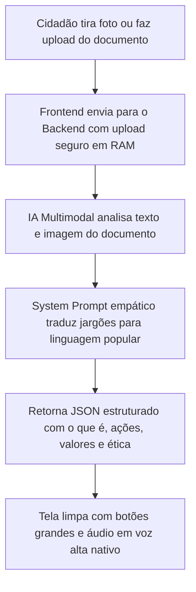

# 📄 Tradutor de Burocracia & Saúde 🇧🇷
### Decodificador Acessível de Documentos Cidadãos com IA Multimodal

> **Projeto de Extensão Universitária focado em Impacto Social e Cidadania**  
> Uma aplicação web simples, responsiva e *mobile-first*, desenvolvida para que cidadãos — especialmente idosos ou pessoas com baixo letramento funcional — compreendam contas públicas, receitas médicas e notificações oficiais sem termos técnicos confusos, contando com recurso nativo de leitura em voz alta.

---

## 🎯 Objetivo e Impacto Social

Muitos cidadãos brasileiros enfrentam grandes barreiras para compreender documentos do dia a dia:
- Contas de água e energia com jargões regulatórios ("bandeira tarifária de escassez", "débito pretérito", "consumo faturado").
- Notificações ou intimações judiciais em linguagem hermética que geram pânico desnecessário.
- Receitas médicas com termos técnicos ("posologia", "via oral", caligrafia ilegível) que dificultam a continuidade do tratamento de saúde.

**O Tradutor Cidadão resolve esse problema traduzindo esses documentos para uma linguagem acolhedora, clara e com passos práticos sobre o que precisa ser feito.**

---

## 🧭 Como Funciona a Aplicação?



1. **Captura Acessível:** O usuário fotografa a **Frente e o Verso** do documento (com slots guiados) ou envia um arquivo PDF.
2. **Decodificação Inteligente (Arquitetura Híbrida):** O backend possui um orquestrador flexível (`aiProvider`) com suporte dual:
   - **Nuvem (Google Gemini):** Utiliza `gemini-2.0-flash` (com cadeia de fallback resiliente) para máxima velocidade, acurácia em receitas médicas e fácil execução em qualquer máquina ou VPS.
   - **Local / Soberana (Qwen-VL via Ollama/LM Studio):** Permite executar localmente modelos multimodais como `qwen2.5-vl:3b` sem limite de requisições e com 100% de privacidade (os dados nunca saem da máquina).
   - **Modo Auto/Híbrido:** Detecta automaticamente se o servidor local está ativo; se não estiver ou se a cota da nuvem esgotar, alterna de forma transparente.
3. **Explicação Humanizada (~5º Ano):** A IA identifica o tipo de documento e remove qualquer jargão técnico, gerando explicações em frases curtas (máx. 15-18 palavras) e voz ativa direta.
4. **Tópicos de Ação Direta:** Apresenta em destaque:
   - **O que é o documento** (ex: "Conta de Luz da Enel referente a Outubro").
   - **O que este papel diz** (resumo em 2 ou 3 frases simples).
   - **Valores e Prazos** (quanto pagar e até quando).
   - **O que você deve fazer** (lista passo a passo numerada).
   - **Alertas Éticos** (ex: receitas médicas reforçam a consulta com o farmacêutico no balcão).
5. **Acessibilidade por Áudio com Karaokê:** O botão **"Ouvir Agora"** aciona a síntese de voz nativa (`window.speechSynthesis`) com **destaque visual em tempo real da frase lida** (efeito karaokê via evento `boundary`), permitindo acompanhar a leitura com facilidade.
6. **Acessibilidade Visual (Zoom Real & Alto Contraste):** Botões **A- / A+** no topo permitem aumentar proporcionalmente todos os textos e cards da aplicação em 4 níveis. Inclui botão de **Modo Alto Contraste** (fundo preto e tipografia amarela de alto contraste).
7. **Tira-Dúvidas Interativo com IA:** O cidadão pode tirar dúvidas sobre o documento usando perguntas frequentes de 1 clique, digitando ou falando pelo **Microfone**, com leitura em voz alta da resposta.

---

## 🛠️ Tecnologias e Dependências

### Backend (API REST)
Construído em **Node.js** com os seguintes pacotes:
- **`@google/genai`**: SDK oficial do Google para comunicação multimodal com o Gemini.
- **`express`**: Framework web para criação dos endpoints HTTP.
- **`zod`**: Validação estrita de schemas tipados para impedir payloads corrompidos ou alucinações.
- **`multer`**: Gerencia uploads exclusivamente em **memória RAM** (descarte imediato pós-análise).
- **`helmet`**: Cabeçalhos HTTP de segurança para mitigação de vulnerabilidades comuns da web.
- **`express-rate-limit`**: Proteção contra abusos, ataques de força bruta e exaustão de cota de IA.
- **`cors`**: Liberação restrita às origens confiáveis do frontend.
- **`dotenv`**: Carregamento seguro de variáveis de ambiente.

### Frontend (Aplicação Web)
Construído em **React** com **Vite** e **Tailwind CSS**:
- **`react` & `react-dom`**: Renderização reativa e componentes modulares.
- **`vite`**: Ferramenta moderna de compilação e servidor de desenvolvimento ultra-rápido.
- **`tailwindcss`**: Estilização utilitária focada em acessibilidade, alto contraste e mobile-first.
- **`lucide-react`**: Conjunto de ícones vetoriais modernos e compreensíveis.
- **`clsx` & `tailwind-merge`**: Utilitários para controle dinâmico de classes de acessibilidade.
- **`Web Speech API`**: API nativa dos navegadores para leitura por voz (dispensa serviços pagos de terceiros).

---

## 📁 Estrutura de Diretórios

```
projeto-idoso/
├── backend/
│   ├── .env.example              # Modelo de configuração (modelo ativo gemma-4-26b-a4b-it)
│   ├── .env                      # Chave da API Gemini (ignorado pelo git por segurança)
│   ├── package.json              # Dependências e script de benchmark (npm run test:eval)
│   ├── server.js                 # Servidor Express com Helmet, Rate-Limit, CORS e Magic-Bytes
│   ├── eval/
│   │   ├── dataset.js            # Conjunto de benchmark com 26 documentos de teste
│   │   └── runEval.js            # Runner de avaliação de acurácia, schemas e segurança
│   ├── schemas/
│   │   └── documentSchema.js     # Schema Zod para validação estrita da resposta da IA
│   ├── prompts/
│   │   ├── documentPrompt.js     # System Prompt e Schema estruturado do Gemini
│   │   └── qaPrompt.js           # Prompt do Tira-Dúvidas contextual
│   ├── services/
│   │   └── geminiService.js      # Integração multimodal com modelos resilientes e retry
│   └── utils/
│       ├── fileValidation.js     # Validação de tipos MIME por Magic Bytes
│       └── logger.js             # Logger sanitizado compatível com LGPD
│
├── frontend/
│   ├── package.json              # Dependências da interface
│   ├── vite.config.js            # Proxy configurado para a porta 3001
│   ├── tailwind.config.js        # Design tokens e tipografia de alta legibilidade
│   ├── postcss.config.js
│   ├── index.html                # Ponto de entrada com metatags de acessibilidade
│   └── src/
│       ├── main.jsx
│       ├── App.jsx               # Fluxo principal, zoom real e estados de tela
│       ├── index.css             # Estilos globais e foco acessível
│       ├── utils/
│       │   └── speech.js         # Controlador da Web Speech API nativa (pt-BR com boundary/karaokê)
│       └── components/
│           ├── Header.jsx        # Cabeçalho com zoom (A- / A+) e Alto Contraste
│           ├── ConsentModal.jsx  # Consentimento explícito LGPD prévio ao primeiro upload
│           ├── ProfessionalDisclaimer.jsx # Aviso explícito de isenção de responsabilidade profissional
│           ├── DocumentUploader.jsx # Captura guiada para Frente e Verso ou PDF
│           ├── LoadingState.jsx  # Feedback acolhedor ("Lendo seu documento...")
│           ├── AudioPlayer.jsx   # Reprodutor acessível (Play/Pause/Velocidade/Karaokê)
│           ├── ResultCard.jsx    # Card estruturado (o que é, ações, prazos, ética)
│           └── DocumentQA.jsx    # Tira-dúvidas com IA, microfone e áudio
│
├── .gitignore                    # Garante que chaves de API e node_modules não sejam commitados
└── README.md                     # Documentação completa
```

---

## 🚀 Guia de Instalação e Execução Passo a Passo

### Pré-requisitos
- [Node.js](https://nodejs.org/) instalado (versão 18 ou superior).

---

### Passo 1: Clonar o Repositório
```bash
git clone https://github.com/GABRIELRODRIGUESCAVALCANTE/projeto-idoso.git
cd projeto-idoso
```

---

### Passo 2: Obter a Chave Gratuita da API do Gemini
1. Acesse o [Google AI Studio](https://aistudio.google.com/).
2. Faça login com sua conta Google (Gmail).
3. Clique em **"Get API key"** e selecione **"Create API key in new project"**.
4. Copie a chave gerada (ela começa com `AIzaSy...`).
> *Nota: O plano gratuito (Free Tier) não exige cartão de crédito e permite até 1.500 requisições diárias.*

---

### Passo 3: Configurar e Rodar o Backend

1. Entre na pasta `backend`:
   ```bash
   cd backend
   ```
2. Instale as dependências:
   ```bash
   npm install
   ```
   *(No Windows PowerShell, use `npm.cmd install` se scripts estiverem desabilitados)*
3. Crie o arquivo `.env` a partir do exemplo:
   - Copie o arquivo `.env.example` e renomeie para `.env`.
   - Configure o provedor desejado (`gemini`, `local` ou `auto`):
   ```env
   PORT=3001

   # Modo de IA: "gemini" (padrão nuvem), "local" (Qwen offline) ou "auto" (híbrido inteligente)
   AI_PROVIDER=auto

   # Configuração Gemini (Nuvem):
   GEMINI_MODEL=gemini-2.0-flash
   GEMINI_API_KEY=sua_chave_do_gemini_aqui

   # Configuração Qwen Local (Opcional via Ollama / LM Studio):
   LOCAL_AI_URL=http://127.0.0.1:11434
   LOCAL_AI_MODEL=qwen2.5-vl:3b
   ```
4. **(Opcional) Para rodar o Qwen Localmente sem limites de cota:**
   - Instale o [Ollama](https://ollama.com/) no seu computador.
   - Baixe e execute o modelo de visão Qwen:
     ```bash
     ollama run qwen2.5-vl:3b
     ```
   - No `.env`, defina `AI_PROVIDER=local` (ou deixe `auto` para detecção automática).
5. Inicie o servidor:
   ```bash
   npm run dev
   ```
   *(Ou `npm.cmd run dev` no Windows PowerShell)*

Você verá a confirmação no terminal:
```text
====================================================
🚀 Servidor Tradutor de Burocracia rodando na porta 3001
🤖 Provedor de IA configurado: [AUTO]
🛡️  Segurança: Helmet, Rate-Limit, CORS e Magic-Bytes ativados
🔒 LGPD: Armazenamento exclusivo em memória RAM (sem disco)
🔗 Health Check: http://localhost:3001/api/health
====================================================
```

---

### Passo 4: Configurar e Rodar o Frontend

1. Abra um **segundo terminal** e entre na pasta `frontend`:
   ```bash
   cd frontend
   ```
2. Instale as dependências:
   ```bash
   npm install
   ```
   *(Ou `npm.cmd install` no Windows PowerShell)*
3. Inicie a interface:
   ```bash
   npm run dev
   ```
   *(Ou `npm.cmd run dev` no Windows PowerShell)*
4. Abra seu navegador no endereço:
   👉 **`http://localhost:5173`**

---

## 🦙 Como Rodar o Modelo Local (Qwen2.5-VL via Ollama)

Se você deseja rodar a Inteligência Artificial **100% no seu computador**, sem limites de requisições por minuto e com privacidade absoluta (as fotos dos documentos nunca saem da sua máquina):

### Passo a Passo:

1. **Instale o Ollama:**
   - Baixe e instale o [Ollama para Windows](https://ollama.com/download/windows) (ou Mac/Linux).
2. **Baixe e execute o Qwen de Visão:**
   - Abra o terminal e rode:
     ```bash
     ollama run qwen2.5-vl:3b
     ```
   - *(Ele fará o download do modelo Qwen2.5-VL de 3 bilhões de parâmetros, que tem ótimo equilíbrio entre velocidade e leitura em português).*
3. **Detecção Automática:**
   - No arquivo `backend/.env`, se estiver com `AI_PROVIDER=auto`, o backend detectará o modelo local automaticamente ao ser iniciado!
   - Se preferir forçar 100% local, defina `AI_PROVIDER=local`.
4. **Inicie o Backend:**
   - Ao rodar `node server.js` ou `npm run dev`, o backend carregará a IA local e processará os documentos sem consumir cotas da nuvem.

---

## 💡 Dica para Usuários Windows (PowerShell)

Se ao executar comandos `npm` você receber a mensagem de erro:
> *"O arquivo npm.ps1 não pode ser carregado porque a execução de scripts foi desabilitada..."*

Você pode resolver de duas formas:
- **Forma rápida:** Adicione `.cmd` após o comando:
  ```powershell
  npm.cmd install
  npm.cmd run dev
  ```
- **Forma definitiva:** Libere a execução de scripts no PowerShell executando:
  ```powershell
  Set-ExecutionPolicy -Scope CurrentUser RemoteSigned
  ```

---

## 🔒 Segurança, Privacidade e LGPD (Lei Geral de Proteção de Dados)

Como a aplicação processa documentos do cotidiano que frequentemente contêm **dados de saúde** (receitas médicas, laudos, exames) e **documentos judiciais/oficiais** (intimações, citações, notificações), estes são classificados como **dados pessoais sensíveis** pela LGPD (**Lei Federal nº 13.709/2018, Art. 5º, II**).

Por isso, o projeto implementa uma arquitetura orientada à privacidade por design (*privacy by design*) com total transparência para o cidadão:

### 1. O que acontece no Servidor Local da Aplicação?
- **Processamento Exclusivo em Memória RAM:** O backend utiliza `multer.memoryStorage()`. As imagens e arquivos PDF recebidos são mantidos estritamente na memória volátil durante a requisição e são descartados imediatamente após a geração da resposta.
- **Zero Persistência em Disco:** O servidor não salva arquivos de imagem no sistema operacional e não possui banco de dados com fotos ou dados de cidadãos.
- **Logs Sanitizados e Seguros:** Nomes de arquivos pessoais, conteúdos extraídos de documentos (OCR), perguntas de cidadãos e respostas da IA **nunca** são registrados em logs de produção, prevenindo vazamentos acidentais de diagnósticos ou informações processuais.

### 2. Para onde vão os dados? (Envio para a IA de Terceiros - Google Gemini)
Para realizar a leitura de caligrafias difíceis e a tradução de termos técnicos, a imagem/PDF é convertida em Base64 e enviada via conexão criptografada (HTTPS) para a API do **Google Gemini**.

> [!WARNING]  
> **Diferença Crítica entre o Plano Gratuito (Free Tier) e o Plano Pago do Google Gemini:**
> - **No Free Tier (Google AI Studio gratuito):** De acordo com os [Termos de Serviço Adicionais do Google AI Studio](https://ai.google.dev/terms), o Google **pode armazenar e utilizar as entradas (prompts, fotos enviadas) e respostas geradas para treinar, aprimorar e refinar seus modelos e produtos de IA**, inclusive com amostragem revisada por humanos com anonimização prévia. **Para documentos contendo dados de saúde e judiciais sensíveis, isso representa um ponto de atenção real de privacidade.**
> - **No Plano Pago / Corporativo (Google Cloud Vertex AI ou Pay-As-You-Go com Faturamento):** Os dados do cliente **NÃO são utilizados para treinar modelos do Google** e não são retidos além do processamento operacional estritamente contratado.
> - **Recomendação para Produção/Órgãos Públicos:** Em implantações reais e governamentais que atendam cidadãos, é mandatória a utilização de chaves vinculadas ao plano corporativo com faturamento ativo do Google Cloud ou modelos locais/privados em nuvem soberana.

### 3. Consentimento Explícito do Cidadão (Art. 7º e Art. 11 da LGPD)
- **Modal Prévio ao Upload:** A interface web exibe uma tela explicativa em linguagem simples e acolhedora antes do primeiro envio de qualquer documento.
- **Escolha Informada:** O cidadão é informado com clareza de que o documento será lido por uma Inteligência Artificial externa e tem a opção de consentir explicitamente ou utilizar o recurso de **"Ver Exemplo Pronto"** para conhecer a ferramenta sem precisar enviar nenhum documento pessoal real.

### 4. Proteções Técnicas Adicionais da API Backend
- **Proteção contra Abuso (Rate Limiting):** Implementação de limites de requisições por IP com `express-rate-limit` (limite geral de 120 req/15 min e limite restrito de 30 req/15 min para rotas que consom a IA), evitando exaustão de cotas e ataques de negação de serviço (DoS).
- **Cabeçalhos de Segurança HTTP (`helmet`):** Inclusão de proteção contra ataques clássicos de web (clickjacking, MIME-sniffing, etc.).
- **Validação Rigorosa de Tipos MIME por Magic Bytes:** Não confia apenas na extensão (`.jpg`, `.pdf`) ou no cabeçalho `Content-Type` enviado pelo cliente. O backend inspeciona a assinatura binária real (hexadecimal) nos primeiros bytes de cada arquivo em memória (`FF D8 FF` para JPEG, `%PDF` para PDF, `89 50 4E 47` para PNG e `RIFF/WEBP` para WebP), bloqueando tentativas de envio de executáveis ou arquivos forjados.
- **CORS Restrito:** Acesso restrito aos domínios autorizados do frontend (configurável via variável `CORS_ORIGIN`), bloqueando chamadas abusivas a partir de páginas terceiras não autorizadas.
- **Limite Estrito de Tamanho:** Upload limitado a 10MB por arquivo e máximo de 4 páginas por requisição.

### 5. Isenção de Responsabilidade Profissional
- A aplicação deixa explícito na interface (tanto na tela inicial quanto nos resultados) que o sistema é uma **ferramenta de apoio educacional e de acessibilidade e NÃO substitui a orientação de profissionais qualificados** (médicos, farmacêuticos, advogados, defensores públicos ou atendentes oficiais de concessionárias de serviços públicos).

---

## 🧪 Mitigação de Riscos Críticos e Suíte de Avaliação (Benchmark)

O maior risco ao aplicar IA em dados de cidadãos vulneráveis é a ocorrência de **alucinações em pontos críticos**, como **dosagem de medicamentos, valores a pagar e prazos judiciais**. Para blindar o sistema contra esses riscos, foram adotadas as seguintes defesas arquiteturais:

### 1. Structured Output Nativo do Gemini
Em vez de depender de instruções livres em linguagem natural pedindo JSON, a aplicação utiliza os parâmetros oficiais do SDK do Google GenAI:
- `responseMimeType: "application/json"`
- `responseSchema: DOCUMENT_RESPONSE_SCHEMA` (OpenAPI Spec nativo)

Isso força a camada de inferência do modelo a seguir estritamente o grafo tipado, reduzindo drasticamente erros de sintaxe ou omissões de campos.

### 2. Validação Rigorosa de Payload com Zod e Retry Automático
Mesmo com structured outputs, o backend submete a resposta a um validador de schema com **Zod** (`documentSchema.safeParse`):
- Se o JSON for malformado ou violar tipos e restrições mínimas, o backend descarta a resposta e aciona um **retry automático com o próximo modelo estável da lista resiliente**.

### 3. Tratamento de Documentos Ilegíveis (`confianca: "baixa"`)
O schema exige que a IA avalie a nitidez da imagem em `confianca` (`alta`, `media` ou `baixa`).
- Se a foto estiver borrada, escura ou cortada, o frontend exibe em destaque um alerta preventivo:  
  *"⚠️ Não consegui ler bem algumas partes deste papel. Para evitar erros graves com valores, remédios ou prazos, recomendamos tirar outra foto com mais iluminação."*

### 4. Tratamento de Imagens Fora do Escopo (`categoria: "FORA_DE_ESCOPO"`)
Se o usuário enviar selfies, memes, animais, paisagens ou documentos estrangeiros desconexos, a IA classifica como fora de escopo e a interface exibe uma orientação amigável e acolhedora em vez de quebrar ou alucinar uma conta pública inexistente.

### 5. Regra Ultraconservadora para Receitas Médicas
- A IA é categoricamente proibida de "adivinhar" nomes de medicamentos ou dosagens rasuradas/ilegíveis.
- O sistema transcreve estritamente o que foi identificado com 100% de clareza e registra explicitamente *"Trecho ilegível no papel — confirme obrigatoriamente com o médico ou farmacêutico"* caso haja qualquer incerteza.

### 6. Destaque Visual com Aviso de Conferência
Valores monetários e prazos de vencimento são apresentados acompanhados de um banner de checagem obrigatório para o cidadão validar com seus próprios olhos:  
*"⚠️ Confira sempre no papel original: R$ 142,50 até 25/10/2024"*.

### 7. Modelo Ativo e Arquitetura Resiliente de Fallback
Para evitar os picos de sobrecarga global (HTTP 503) e as cotas estritas de 20 requisições/dia dos modelos experimentais do Free Tier, o projeto adota o modelo multimodal **`gemma-4-26b-a4b-it`** como padrão ativo, configurável via variável `GEMINI_MODEL`.
- O backend implementa uma **cadeia automática de fallback** (`gemma-4-26b-a4b-it` → `gemini-3.6-flash` → `gemini-3.1-flash-lite` → `gemini-3.8-flash`).
- Qualquer oscilação transitória do Google (500 INTERNAL, 502, 503 UNAVAILABLE ou 429 RESOURCE_EXHAUSTED) aciona imediatamente o próximo modelo resiliente sem quebrar a requisição do cidadão.

### 8. Conjunto de Avaliação Contínua (26 Casos de Teste)
Criada uma suíte automatizada de testes (`eval/dataset.js` e `eval/runEval.js`) contendo **26 documentos sintéticos e anonimizados** (contas públicas, receitas legíveis, receitas ilegíveis/rasuradas, notificações judiciais, benefícios sociais e memes fora de escopo).

Para rodar a avaliação antes de qualquer mudança de prompt ou modelo:
```bash
cd backend
npm.cmd run test:eval -- --offline
```
*(Ou `npm run test:eval` para testar ao vivo contra a API do Google).*

### 9. Acessibilidade Universal e Conformidade WCAG 2.2 Nível AA
A interface web foi desenhada sob as diretrizes de acessibilidade internacional **WCAG 2.2 Nível AA**, garantindo inclusão digital para idosos e pessoas com deficiência ou baixo letramento:
- **Destaque Dinâmico de Leitura (Efeito Karaokê):** O reprodutor de áudio sincroniza a leitura por voz (`speechSynthesis`) com o texto na tela via eventos `boundary`, destacando visualmente a frase exata que está sendo lida.
- **Modo Alto Contraste:** Botão dedicado no cabeçalho ativa instantaneamente o tema de alto contraste (fundo preto e tipografia amarela brilhante).
- **Alvos de Toque Mínimos de 44x44px:** Todos os botões, opções de velocidade e cards respeitam a diretriz WCAG 2.5.8 de tamanho mínimo para evitar toques acidentais em telas sensíveis ao toque.
- **Rótulos Duplos (Ícone + Texto):** Todos os botões principais utilizam ícone visual acompanhado de texto claro e descritivo (nunca ícones isolados).
- **Compatibilidade com Leitores de Tela:** Atributos semânticos e regiões `aria-live="polite"` anunciam o progresso da análise e os resultados para softwares como TalkBack, NVDA e VoiceOver.
- **Respeito a `prefers-reduced-motion`:** Usuários com sensibilidade a animações têm transições atenuadas automaticamente pelo CSS.
- **Linguagem Acessível (~5º Ano):** O mediador social com IA gera textos com frases curtas (máximo de 15 a 18 palavras) em voz ativa direta, eliminando barreiras de compreensão.

---

## 🤝 Projeto de Extensão Universitária

Este projeto foi concebido como uma iniciativa acadêmica de extensão para democratizar o acesso à informação e apoiar cidadãos em vulnerabilidade informacional através do uso consciente de Inteligência Artificial generativa.
